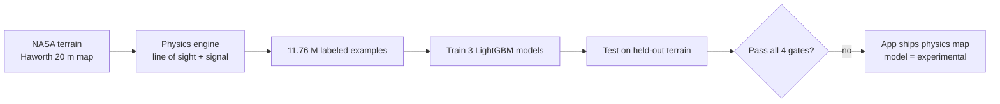

# The MOONMESH coverage model, explained

A plain-language guide to the machine-learning model we trained for MOONMESH's
**Surface coverage** feature: what it does, what it learned from, how it was
trained and tested, how well it works, and why the app still uses the physics
calculation by default.

> Everything here is **simulated**. Nobody has measured radio signals on the
> lunar surface, so both the training labels and the test results come from our
> physics engine, not from real lunar measurements.

---

## 1. The short version

- **Task:** given a radio tower somewhere near the Haworth region at the lunar
  south pole, predict which spots on the ground around it can receive a usable
  signal (**covered**) and which can't (**dead zones**).
- **Model:** three LightGBM models trained together, from scratch, on
  **11.76 million** simulated examples.
- **Accuracy on terrain it never trained on:** it finds **98.8%** of dead zones,
  gets line of sight right **98.7%** of the time, and predicts signal strength to
  within **0.58 dB** on average.
- **Result:** it is accurate but **not approved**. It failed three of the four
  pass/fail gates we fixed before testing:
  - it misses slightly too many dead zones (1.19% against a 1% limit)
  - its dead-zone edges can be off by up to 374 m (limit 60 m)
  - it is about 12× **slower** than the physics calculation it was meant to speed up
- **So:** the app shows the exact physics map. The model is available as a clearly
  labeled **experimental comparison**.

---

## 2. The problem it solves

Picture a lander or base with a radio on a mast. Astronauts and rovers nearby carry
radios 2 m off the ground. The south pole is full of crater rims, ridges and deep
shadows, so a rover 3 km away might have a perfect signal while one 500 m away,
behind a ridge, has none.

MOONMESH answers this with a **physics calculation** on NASA terrain. For every
20 m patch of ground within 8 km of the tower, it:

1. traces the straight line between the two antennas over the curved Moon, checking
   whether terrain blocks it (**line of sight**)
2. works out how strong the signal is when it arrives, including the signal loss
   from distance and the extra loss from bending around the edge of a ridge
   (**knife-edge diffraction**)
3. compares that to what the receiver needs, which gives the **link margin**:
   margin ≥ 3 dB means covered, below that means dead zone

That calculation is exact for our model of physics, but it repeats the trace for
hundreds of thousands of patches. The idea was to train a **surrogate model**: a
machine-learning model that has studied millions of physics answers and can guess
new ones quickly, the way an experienced person eyeballs a map instead of measuring
every line.



---

## 3. What it learned from

### Terrain
- **NASA GSFC LOLA PGDA 90** digital elevation model (`LDEM_80S_20MPP_ADJ`): the
  height of the lunar surface every 20 m around Haworth crater.
- From that we computed slope, roughness and "relative elevation" (how high a spot
  sits compared with its surroundings at 200 m and 1,000 m scales).

### Radio setup (fixed for all training)
| Setting | Value |
|---|---|
| Frequency | 2.4 GHz |
| Transmit power | 33 dBm (2 W) |
| Antenna gain | 4 dBi at each end |
| Fixed losses | 3 dB |
| Receiver sensitivity | −105 dBm |
| Margin needed for "covered" | 3 dB |
| Maximum range | 8 km |
| Tower (transmitter) heights | 5, 10, 20 and 50 m |
| Receiver height | 2 m (a person or rover) |

### Examples
- **147 tower locations × 4 mast heights = 588 scenarios.**
- For each scenario, **20,000 receiver spots**:
  - 15,000 chosen at random
  - up to 5,000 extra near the edge between covered and dead, where mistakes matter
    most and are hardest
- **11,760,000 examples in total**, each labeled by the physics engine with:
  - line of sight yes/no
  - link margin in dB
  - terrain clearance in meters
- Roughly half of the random spots are covered (55% in training, 51% in validation
  and test), so the data is balanced.

### Keeping the test honest
A model can "cheat" by memorizing terrain it has already seen. To prevent that, we
split the data **by geography, not at random**:

- the map was divided into 5 km blocks
- every tower, with all four of its mast heights, belongs to exactly one group:

| Group | Towers | Used for |
|---|---:|---|
| Training | 106 | Learning |
| Validation | 21 | Tuning and deciding when to stop training |
| Test | 20 | The final exam, opened once at the end |

- Training towers were kept at least **8.6 km** from validation and test towers.
- The receiver areas still overlap slightly, by 1.2% of the test area, so the
  separation isn't perfect.
- The final exam was time-boxed: it ran on 6 of the 20 test towers, with all four
  mast heights (24 of the 80 test scenarios). The 6 were picked by a fixed random
  rule before any results were seen.

### Is the physics engine itself trustworthy?
We checked our physics engine against an independent simulator, WPI's **LunarRF
atlas** (CC BY 4.0), across 267 of its radio masts:
- line-of-sight maps overlapped **99.5%**
- coverage maps overlapped **95.2%**
- the median signal-strength difference was **−0.01 dB**

The two simulators agree closely. That shows our engine is consistent with another
careful simulator. It is still not a real-world measurement.

---

## 4. What the model looks at (35 inputs)

For each tower-and-receiver pair, the model gets 35 numbers:

| Group | Inputs | Count |
|---|---|---:|
| Geometry | distance, direction (sin/cos of bearing), tower height, receiver height, frequency, ground height at each end, height difference | 9 |
| Terrain at each end | slope, relative elevation at 200 m and 1,000 m, roughness, for both the tower and the receiver | 8 |
| Horizon | how high the horizon looks from the tower in the receiver's direction; the steepest terrain angle along the path | 2 |
| Terrain profile | terrain height at 16 evenly spaced points along the straight antenna-to-antenna line | 16 |

The **terrain profile** is the key idea. It measures how far the ground pokes above
or below the line of sight at 16 points:

```
 tower mast                                              receiver (2 m)
     |\                                                         |
     | \___________ straight line between antennas ____________/|
     |   ·   ·   ·   ·   ·   ·  /\ ·   ·   ·   ·   ·   ·   ·   · |
_____|__________________________/  \_____________________________|____
        p00 ...                 ridge pokes up here (positive)  ... p15
```

Positive values mean terrain sticks up into the line of sight. Negative values mean
the line clears the ground.

**What it is NOT allowed to see:** anything that would give away the answer, such as
the exact traced clearance, obstruction location, line-of-sight or margin values,
IDs, or which split a row belongs to. The code enforces this list and refuses to
train if any forbidden input slips in.

---

## 5. The three models

"The model" is really three LightGBM models that share the same 35 inputs:

| Model | Predicts | Type | Training objective | Rounds used | Training time | File size |
|---|---|---|---|---:|---:|---:|
| **LOS** | Is there a clear line of sight? | Yes/no classifier | Log loss | 357 | ~13 min | 2.6 MB |
| **Margin** | Link margin in dB | Number (regression) | Huber loss | 1,798 | ~51 min | 12.9 MB |
| **Clearance** | How far the path clears terrain, in meters | Number (regression) | Huber loss | 2,000 (hit the limit) | ~57 min | 14.4 MB |

**How they combine:** the covered/dead map comes from the **margin model**: a spot
is covered if predicted margin ≥ 3 dB, or whatever threshold you set in the app. The
LOS and clearance models are reported alongside it. They matter because a spot can
be blocked by terrain (no LOS) and still be covered by a signal bending over a ridge.

### What is LightGBM?
LightGBM builds **gradient-boosted decision trees**:
- a decision tree is a chain of yes/no questions, such as "is profile point 13 more
  than 4 m above the line?"
- training adds trees one at a time, and each new tree focuses on fixing the mistakes
  of the trees before it
- after hundreds or thousands of rounds, the trees together give an accurate answer

It is fast to train on tens of millions of rows, handles missing values, and works
well on table-style data like ours.

### Training settings
| Setting | Value |
|---|---|
| Leaves per tree | 63 |
| Learning rate | 0.05 |
| Maximum rounds | 2,000 |
| Early stopping | stop if validation hasn't improved for 50 rounds |
| Huber alpha (regressors) | 0.9 (less sensitive to a few extreme errors than squared error) |
| Sample weights | edge spots weighted to undo the extra edge sampling; LOS classes balanced |
| Random seed | 42 |
| Library | LightGBM 4.7.0, no pretrained weights |

The **clearance** model hit the 2,000-round limit while still improving, so it could
get better with more training.

---

## 6. What it learned

LightGBM can report which inputs did the most work, measured as each input's share
of the total "gain" from all its decisions:

| Model | Most important inputs | Weight of plain distance |
|---|---|---:|
| LOS | profile points 13, 14 (near the receiver) and 02, 03 (near the tower) | 1.7% |
| Margin | profile points 06, 09, 08, 14, 15, 02 | 6.7% |
| Clearance | profile points 07, 08 (the middle of the path) | 0.2% |

**What this means:** the model really reads the terrain between the antennas. It did
not learn a shortcut like "far away = no signal". It makes physical sense, too:
- for line of sight, obstacles close to either antenna matter most, because they
  block the steepest part of the view
- for clearance, the middle of a long path is where a ridge sits closest to the line

---

## 7. How well it works

### Compared with a simple baseline (validation, 1.26 million points)
The "distance-only" baseline assumes a smooth, featureless Moon: free-space signal
loss plus the horizon of a perfect sphere, ignoring all terrain. This shows how much the terrain-reading model adds.

| Measure | Distance-only baseline | **Our LightGBM model** |
|---|---:|---:|
| Line-of-sight accuracy | 34.6% | **98.7%** |
| Dead zones found (recall) | 9.8% | **98.8%** |
| Dead zones wrongly called "covered" | 90.2% | **1.2%** |
| Average signal error | 21.5 dB | **0.57 dB** |
| Signal error near the covered/dead cutoff | 26.6 dB | **0.70 dB** |
| Average clearance error | n/a | 20.1 m |

### Final exam (test terrain, never seen during training)
24 test scenarios (6 of the 20 test towers × 4 heights; a time-boxed subset of
the 80 test scenarios), full maps, about **12.1 million** pixels:

| Measure | Result | What it means |
|---|---:|---|
| Dead-zone precision | 99.2% | When it says "dead", it's right 99.2% of the time |
| Dead-zone recall | 98.8% | It finds 98.8% of all dead-zone area |
| Dead-zone overlap (IoU) | 0.98 | Predicted and true dead zones overlap almost exactly (1.0 = perfect) |
| Covered-area overlap (IoU) | 0.97 | Same for covered areas |
| Wrongly "covered" | 1.18% (1.19% for line-of-sight dead zones) | Share of true dead-zone area it called covered |
| Average signal error | 0.58 dB | Typical miss in signal strength |
| Signal error near cutoff | 0.75 dB | The cases that decide covered vs dead |
| Average edge error | 46 m | Typical distance its dead-zone edges are off |
| Worst edge error (95th percentile, worst map) | 374 m (233 m for line-of-sight edges) | Where it struggled most |

---

## 8. The pass/fail gates, and why it wasn't approved

Before testing, we wrote four requirements into `training/configs/acceptance.yaml`
and froze them. A checksum of that file is recorded, so the requirements could not
be loosened after seeing results:

| Requirement | Limit | Model | Result |
|---|---:|---:|:---:|
| Dead-zone area wrongly called "covered" | ≤ 1% | 1.19% | ❌ |
| Worst dead-zone edge error (95th percentile) | ≤ 60 m | 374 m | ❌ |
| Signal error near the cutoff | ≤ 2 dB | 0.75 dB | ✅ |
| Speed vs the physics calculation | ≥ 10× faster | 0.08× (12× slower) | ❌ |

Each gate uses the worse of the line-of-sight and radio-coverage results, so the
1.19% is the line-of-sight figure (1.18% for radio coverage) and the 374 m is the
radio-coverage figure (233 m for line of sight).

**Decision (`reports/eval/final/decision.json`): ship the deterministic physics map.**

### Why each gate failed
- **Wrongly "covered" (1.19%).** Close, but over the line. This is the most
  dangerous kind of mistake, because an astronaut would expect a signal that
  isn't there. That's why the limit is strict.
- **Edge error (374 m).** The model is accurate *on average* (46 m), but in its
  worst map some dead-zone edges land hundreds of meters off. Thin dead zones and
  sharp rims are hard to capture with 16 profile points spaced along an 8 km line.
- **Speed (105 s vs 8.7 s per map).** Before the model can guess, the app has to
  compute all 35 inputs for every pixel, including the 16-point terrain profile and
  the horizon, and then run three large models. That costs more than simply running
  the physics. The physics engine itself had been optimized about 8× earlier in the
  project, which raised the bar the model had to beat.

### Why this is still a good result
Training a model, testing it fairly on unseen terrain, and then saying no because it
missed requirements set in advance is how responsible engineering works. It shows
judges that MOONMESH's maps rest on validated physics, and that we didn't ship a
model just because it scored "98%".

---

## 9. Where to see it

| Where | How |
|---|---|
| In the app | Analysis menu → **Surface coverage** → **Calculate surface coverage**, then **Compare with ML model** under "Experimental: compare with your ML model". Shows the physics map, the model's map and where they disagree (red = model says covered but physics says dead). At the full 8 km range it takes about 30 seconds to 2 minutes; the first run after starting the app is the slowest. |
| From the command line | With the training environment active: `python training/scripts/try_model.py --lat -86.8 --lon 337.2 --h-tx 5`. It produces a 3-panel picture and scores |
| Model files | `models/tabular/` under the data folder (`los.txt`, `margin.txt`, `clearance.txt`, `metadata.json`). They ship on GitHub inside the split zip in `shared-data/` |
| Setting it up on another computer | `shared-data/README.md`: unpack the zip (`shared-data/unpack.ps1` on Windows, or `python shared-data/unpack.py` on any system), create the training environment, start the app |
| Proof it runs | `training/tests/test_real_model.py` loads the real model files, runs them through the app and reproduces the published result for a held-out test scenario. CI runs it on every push |

The app's comparison runs only the LOS and margin models; the clearance model is not
needed for the map, so it is skipped to save time.

The model only runs inside the conditions it was trained and tested on:
- the Haworth site
- the 2.4 GHz MOONMESH radio profile
- tower height 5–50 m, receiver height 2 m
- range up to 8 km
- a tower whose whole 8 km range is on the prepared Haworth terrain, which is the
  same rule that placed every training, validation and test tower

For anything outside that, the app refuses and explains why.

Use the full 8 km range when comparing with the numbers above. Short ranges have
little dead area: at 3 km around the research point it is about 0.2 km², so a few
pixels swing the percentages (the model caught 72% of it there, against 99.3% of the
128 km² dead area at 8 km).

---|---|
| In the app | Surface coverage → Calculate → **Compare with ML model (experimental)**. Shows the physics map, the model's map and where they disagree (red = model says covered but physics says dead). |
| From the command line | In the hackNasa folder, with `$env:MOONMESH_DATA_ROOT = "C:\moonmesh-data"` set: `C:\moonmesh-data\venv\Scripts\python.exe training\scripts\try_model.py --lat -86.8 --lon 337.2 --h-tx 5`. It produces a 3-panel picture and scores |
| Model files | `C:\moonmesh-data\models\tabular\` (`los.txt`, `margin.txt`, `clearance.txt`, `metadata.json`), also in `shared-data/` on GitHub |

The model only runs inside the conditions it was trained on:
- the Haworth site
- the 2.4 GHz MOONMESH radio profile
- tower height 5–50 m, receiver height 2 m
- range up to 8 km

For anything outside that, the app refuses and explains why.

---

## 10. Limitations

- **Simulated, not measured.** The labels come from our physics engine. No real
  lunar radio measurements exist to check against.
- **Simplified physics.** Signal loss from distance plus single knife-edge
  diffraction. It ignores reflections, multiple ridges, antenna patterns, and
  hardware or environmental effects.
- **One site.** Trained and tested only at Haworth. Malapert and Nobile Rim were
  never tested.
- **One radio setup.** Different frequencies, power levels or receiver heights
  weren't trained on.
- **Data questions still open.** The exact height reference (vertical datum) of the
  NASA terrain files and their license terms aren't recorded yet.
- **Imperfect geographic separation.** About 1.2% of the test area overlaps
  training areas.
- **Clearance model unfinished.** It hit the training-round limit while still
  improving.
- **Final exam on a subset.** 24 of the 80 test scenarios (6 of 20 test towers)
  were evaluated, to fit the time available.

---

## 11. How it could get better

- **Faster inputs.** Computing the terrain profile is the bottleneck. Cheaper
  features, or computing them on a GPU, could flip the speed result.
- **An image model.** A U-Net, which reads the whole terrain map like a picture and
  draws the coverage map in one pass, was planned but skipped for time. It could
  handle edges and speed better.
- **Focus on edges.** Add more profile points or edge-specific features where the
  model makes its biggest mistakes.
- **More sites and radio setups**, so it generalizes beyond Haworth.
- **Use it as a filter, not the final answer.** Let the model quickly shortlist
  likely-good tower spots, then confirm the shortlist with exact physics. Your
  teammates' ORA relay tools follow the same pattern.

---

## 12. Glossary

| Term | Meaning |
|---|---|
| **Line of sight (LOS)** | Whether a straight line between the two antennas clears the terrain |
| **Link margin** | How much stronger the received signal is than the minimum the radio needs, in decibels (dB). Positive margin means it works, with room to spare |
| **dB (decibel)** | A log scale for signal strength. +3 dB ≈ double the power, +10 dB = 10× |
| **Diffraction** | Radio waves bending over the edge of an obstacle, so a blocked path can still carry some signal |
| **Dead zone** | A spot where the margin is below the required 3 dB |
| **Surrogate model** | A fast machine-learning stand-in for a slower exact calculation |
| **Precision / recall** | Precision: when it says "dead", how often it's right. Recall: of all real dead zones, how many it found |
| **IoU** | Intersection over union: how much two maps overlap, from 0 (none) to 1 (identical) |
| **95th percentile** | The value 95% of cases fall under, which describes the bad tail rather than the average |
| **Huber loss** | A training error measure that treats small errors like squared error and large ones more gently, so a few outliers don't dominate |
| **Early stopping** | Stopping training when the validation score stops improving, to avoid memorizing the training data |

---

## 13. Where the full details live

Paths are relative to the data folder (`C:\moonmesh-data`) unless they start with
`training/`:

| File | Contents |
|---|---|
| `training/MODEL_CARD.md` | Technical model card |
| `training/configs/tabular_haworth.yaml` | Training settings |
| `training/configs/acceptance.yaml` | The four frozen pass/fail gates |
| `training/configs/radio_profiles.yaml` | The radio setup |
| `training/splits.json` | Which towers are in train, validation and test |
| `reports/dataset/report.md` | How the 11.76 M examples were built |
| `reports/models/tabular_val.md`, `tabular_audit.json` | Training and validation results |
| `reports/eval/final/summary.md`, `metrics.json` | Final test results |
| `reports/eval/final/decision.json` | The ship/no-ship decision |
| `reports/exp_a/report.md` | Physics engine vs the LunarRF atlas |
| `models/tabular/feature_importance.png` | Feature importance chart |
| `shared-data/README.md` | How to unpack the model and run it on another computer |
| `training/tests/test_real_model.py` | Tests that run the real model inside the app |
